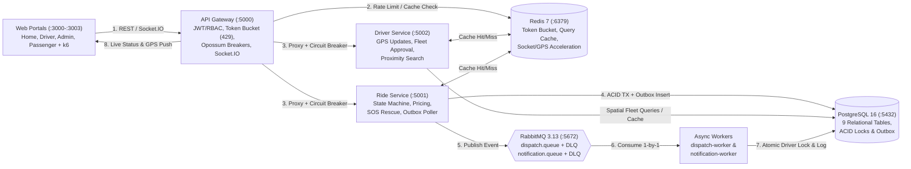

# GoDrop (RideFlow) — Distributed Ride Booking & Driver Dispatch System

> README: how to build, run, verify, and load-test the system. A containerised, event-driven microservices platform that dispatches nearby drivers in Ahmedabad, manages ride lifecycles atomically in PostgreSQL, streams real-time GPS telemetry over Socket.IO, and includes an In-Ride Emergency SOS & Rescue Command Center.

---

## 1. What this project does

GoDrop connects **Passengers**, **Drivers**, and **Administrators** across dedicated web portals backed by a distributed Node.js microservice architecture. When a passenger requests a ride, heavy dispatch matching is decoupled from the HTTP write path: the **Ride Service** validates the fare and state transition, persists the ride alongside a **Transactional Outbox** event in **PostgreSQL 16**, and relays jobs through **RabbitMQ 3.13** to asynchronous **Dispatch** and **Notification** workers that rank nearby drivers using the Haversine formula and reserve a driver with atomic database locks.

During an active trip, passengers can trigger an **In-Ride Emergency SOS** alert that streams live telemetry to the **Admin Command Center**, suspends the flagged driver (`SUSPENDED_SOS`), and dispatches a free (`₹0` fare) rescue cab. Around that core sit every distributed-systems reliability control required in production: a Redis-backed **Token Bucket rate limiter (`429`)**, a **Redis cache-aside layer**, **Opossum circuit breakers** with Redis fallback, **health check & metrics endpoints**, **structured Pino JSON logs** with `x-request-id` correlation IDs, and **Grafana k6 load tests**.

---

## 2. Quick start

```powershell
git clone https://github.com/Krish2139/GoDrop.git
cd GoDrop
copy .env.example .env          # optional: customize ports or credentials
docker compose up -d --build    # first run builds images; later runs: docker compose up -d
```

Once all 9 containers pass their Docker health checks, initialize and seed the Ahmedabad fleet dataset if starting from an empty database:

```powershell
npm install
npm run db:migrate
npm run db:seed
```

Stop the stack with `docker compose down`. To wipe database volumes and start completely fresh, run `docker compose down -v`.

### Prerequisites

- **Docker Engine / Docker Desktop** with **Compose v2** (`docker compose`)
- **Free local ports:** `3000`, `3001`, `3002`, `3003`, `5000`, `5001`, `5002`, `5432`, `5672`, `6379`, `15672`
- **Node.js 20+** (for running local unit/integration tests, migrations, and verification scripts)
- `.env.example` in the project root provides default ports, database credentials, Redis/RabbitMQ settings, and JWT secrets

### Where to look once it is running

| What | URL |
| :--- | :--- |
| Home Portal & Navigation | http://localhost:3000 |
| System Architecture (Live Health & Load Test Matrices) | http://localhost:3000/architecture |
| Driver Terminal Portal | http://localhost:3001 |
| Administrator Operations & SOS Command Center | http://localhost:3002 |
| Passenger Booking Portal | http://localhost:3003 |
| API Gateway Health Check | http://localhost:5000/health |
| Aggregated Downstream Service Health | http://localhost:5000/api/v1/health/services |
| Gateway Telemetry & Metrics (Cache Hit Ratio, 429s, Circuit State) | http://localhost:5000/api/v1/metrics |
| RabbitMQ Management UI (login `guest` / `guest`) | http://localhost:15672 |

**Demo Credentials (after running `npm run db:seed`):**
- **Admin:** `admin@rideflow.io` / `admin123` (works even after clearing tables)
- **Passenger:** `passenger@rideflow.io` / `pass123`
- **Driver:** `driver@rideflow.io` / `driver123`

---

## 3. Architecture and data flow



Numbered steps trace a request end to end across the stack:

1. **Entry & Security.** Every request enters the **API Gateway** (`:5000`), which attaches or preserves an `x-request-id` correlation header, enforces the Redis **Token Bucket** limiter (`300` capacity / `25` tokens/sec, returning `429 Too Many Requests` when exhausted), and validates JWT tokens + live DB account checks (`SUSPENDED_SOS` enforcement).
2. **Cached Read.** Read-heavy endpoints (`GET /api/v1/drivers/nearby`, `/api/v1/drivers`, `/api/v1/rides`) check **Redis 7** first with cache-aside TTL and automatic cache invalidation on writes.
3. **Resilient Proxy & Cache Miss.** On cache miss or write, the Gateway routes through **Opossum Circuit Breakers** (`rideServiceBreaker` and `driverServiceBreaker`, `3,000 ms` timeout, `50%` error threshold, `4,000 ms` reset window). If a downstream service fails or times out, the breaker opens and serves either a `Redis-Graceful-Fallback` snapshot (`X-Resilience-Fallback: REDIS_CACHE`) or an HTTP `503` fast-fail (`X-Circuit-Breaker: OPEN`, `Retry-After: 4`).
4. **ACID Write + Outbox.** Booking a ride (`POST /api/v1/rides`) executes inside a PostgreSQL transaction: validating the ride state machine, calculating Haversine fare (`₹50 + ₹18.50/km * surge`), inserting into `rides`, and writing a `RIDE_REQUESTED` record into `outbox_events` atomically.
5. **Broker Delivery.** The Ride Service Outbox relay publishes persistent messages to **RabbitMQ 3.13** exchanges and queues (`dispatch.queue`, `notification.queue`), backed by a Dead-Letter Exchange (`rideflow.dlx`) and DLQs (`dispatch.dlq`, `notification.dlq`).
6. **Worker Execution.** `dispatch-worker` (`prefetch(1)`) checks `tasks` for idempotency, invokes `POST /api/v1/rides/:id/dispatch` to rank available drivers in a 25 km radius, and atomically locks one driver (`AVAILABLE` → `RESERVED`). `notification-worker` persists multi-channel alert logs in `notifications`.
7. **Live GPS & Emergency SOS.** Drivers stream GPS telemetry (`PATCH /api/v1/drivers/:id/location`) every 3s. Triggering `POST /api/v1/sos/trigger` creates an active record in `sos_incidents`, alerts Admin immediately over Socket.IO, and supports suspending the driver (`SUSPENDED_SOS`), aborting the compromised trip (`ABORTED_SOS`), and dispatching a free (`₹0`) rescue cab.
8. **Real-Time Display.** **Socket.IO** pushes instant booking offers, ride state transitions, GPS coordinates, and SOS alerts to connected Passenger, Driver, and Admin portals, while `/architecture` aggregates live health probes and load test benchmarks.

---

## 4. Services and ports

| Service | Role | Port (Host) | Technology |
| :--- | :--- | :--- | :--- |
| `api-gateway` | Ingress reverse proxy, JWT/RBAC, Token Bucket rate limiter, Opossum circuit breakers, Socket.IO, `/health`, `/metrics`, `/chaos` | `5000` | Node.js 20, Express, Opossum, Pino |
| `ride-service` | Ride lifecycle state machine, Haversine pricing & surge multiplier, Transactional Outbox relay, SOS Rescue APIs | `5001` | Node.js 20, Express, pg, Redis, amqplib |
| `driver-service` | Driver profile/approval lifecycle, 25 km geospatial discovery, availability locks, 3s GPS location updates, Redis fleet cache | `5002` | Node.js 20, Express, pg, Redis |
| `postgres` | Authoritative relational store (9 tables, spatial & status indexes, `updated_at` triggers) | `5432` | PostgreSQL 16 (Alpine) |
| `redis` | Distributed Token Bucket rate limiter, cache-aside query store, surge/telemetry store | `6379` | Redis 7 (Alpine) |
| `rabbitmq` | Durable queues (`dispatch.queue`, `notification.queue`) + Dead-Letter Queues (`*.dlq`) | `5672` / `15672` (UI) | RabbitMQ 3.13 Management |
| `dispatch-worker` | Consumes `dispatch.queue` (`prefetch(1)`), idempotency via `tasks`, triggers atomic driver matching | none (worker) | Node.js 20, amqplib, pg |
| `notification-worker` | Consumes `notification.queue`, logs simulated push/SMS/socket alerts to `notifications` with DLQ fallback | none (worker) | Node.js 20, amqplib, pg |
| `frontend` | Nginx-served React 19 SPA mapped across role-dedicated host ports (`3000` Home/Architecture, `3001` Driver, `3002` Admin, `3003` Passenger) | `3000`, `3001`, `3002`, `3003` | React 19, Vite, Leaflet, Nginx |

---

## 5. API reference (through the gateway, port `5000`)

| Method & Path | Purpose |
| :--- | :--- |
| `GET /health` or `/api/v1/health` | Gateway status, uptime, heap memory, and Redis connectivity. |
| `GET /api/v1/health/services` | Aggregated downstream health across `ride-service` and `driver-service` (`200` healthy, `207` degraded). |
| `GET /api/v1/metrics` | Request breakdown (`2xx`/`4xx`/`5xx`), Redis memory & 429 count, Socket.IO stats, RabbitMQ queues, and circuit breaker states. |
| `POST /api/v1/auth/register` | Registers `PASSENGER` or `DRIVER` (atomic PG transaction enforcing unique email and license plate; `409` on duplicate). |
| `POST /api/v1/auth/login` | Authenticates user with `bcryptjs` and issues a signed JWT (rejects `SUSPENDED_SOS` drivers). |
| `GET /api/v1/auth/me` | Validates JWT and verifies account liveness against PostgreSQL. |
| `GET /api/v1/drivers/nearby?lat=&lng=&radius=` | Geospatial driver lookup in Ahmedabad cached in Redis. |
| `PATCH /api/v1/drivers/:id/approval` | Admin approves (`APPROVED`) or rejects (`REJECTED`) pending driver applications. |
| `PATCH /api/v1/drivers/:id/availability` | Driver toggles between `AVAILABLE` and `OFFLINE`. |
| `PATCH /api/v1/drivers/:id/location` | Streams live GPS coordinates (`lat`, `lng`, `heading`). |
| `POST /api/v1/rides` | Books a ride (`PASSENGER`/`ADMIN`/`DRIVER`), writes Outbox event, queues async dispatch. |
| `POST /api/v1/rides/:id/accept` / `arrived` / `start` / `complete` / `cancel` | Advances ride through strictly validated state machine transitions. |
| `GET` / `PUT /api/v1/rides/pricing/surge` | Reads or updates dynamic surge multiplier (`1.0x` – `3.0x`). |
| `POST /api/v1/sos/trigger` | Raises an active SOS emergency incident for an in-progress ride. |
| `GET /api/v1/sos/incidents` | Lists SOS incidents for the Admin Command Center. |
| `POST /api/v1/sos/:incidentId/suspend-driver` / `dispatch-rescue` / `resolve` | Suspends flagged driver (`SUSPENDED_SOS`), dispatches free rescue cab, or resolves incident. |
| `GET /api/v1/chaos/status` | Reports Opossum breaker states (`CLOSED`, `HALF-OPEN`, `OPEN`) and active fault injection mode. |
| `POST /api/v1/chaos/inject` / `reset` | Injects downstream `error`/`delay`/`trip` faults or resets circuits back to `CLOSED`. |

Useful response headers: `x-request-id`, `X-Circuit-Breaker`, `X-Resilience-Fallback`, `Retry-After`.

```powershell
Invoke-RestMethod http://localhost:5000/api/v1/health/services
Invoke-RestMethod "http://localhost:5000/api/v1/drivers/nearby?lat=23.0275&lng=72.5076&radius=15"
```

---

## 6. Configuration (`.env`)

| Variable | Default | Meaning |
| :--- | :--- | :--- |
| `GATEWAY_PORT` | `5000` | Public port for the Express API Gateway & Socket.IO server |
| `RIDE_SERVICE_PORT` / `DRIVER_SERVICE_PORT` | `5001` / `5002` | Internal/host ports for Ride and Driver domain services |
| `POSTGRES_HOST` / `POSTGRES_PORT` | `localhost` (`postgres` in Docker) / `5432` | PostgreSQL connection host and port |
| `POSTGRES_DB` / `POSTGRES_USER` / `POSTGRES_PASSWORD` | `rideflow_db` / `rideflow_user` / `rideflow_secure_password` | PostgreSQL database credentials |
| `REDIS_HOST` / `REDIS_PORT` | `localhost` (`redis` in Docker) / `6379` | Redis cache and rate-limiter connection |
| `RABBITMQ_HOST` / `RABBITMQ_PORT` | `localhost` (`rabbitmq` in Docker) / `5672` | RabbitMQ AMQP broker (`15672` for Management UI) |
| `RABBITMQ_USER` / `RABBITMQ_PASSWORD` | `guest` / `guest` | RabbitMQ credentials |
| `JWT_SECRET` / `JWT_EXPIRES_IN` | `super_secret_jwt_key_rideflow_academic_system_design_2026` / `24h` | JWT signing key and token lifetime |
| `VITE_API_URL` / `VITE_SOCKET_URL` | `http://localhost:5000/api/v1` / `http://localhost:5000` | Frontend Gateway REST and Socket.IO endpoints |

After changing `.env` or container configuration, re-apply with `docker compose up -d`.

---

## 7. Demo and verification guide

### 7.1 Use the portals & live System Architecture page

1. Open **Home** (`http://localhost:3000`) and click **System Architecture** in the top navigation bar (`http://localhost:3000/architecture`) to view the **Live System Health & Resilience Test Matrix** and **Concurrent Load Testing Benchmark Results (Load Test Matrix)**. Click **Refresh Health Matrix** or **Run Live Load Burst** to benchmark `localhost:5000` live from the browser.
2. Open **Admin Portal** (`http://localhost:3002`), sign in with `admin@rideflow.io` / `admin123`, approve newly registered drivers, adjust Surge Pricing (`1.0x`–`3.0x`), and monitor the fleet map and SOS Command Center.
3. Open **Driver Portal** (`http://localhost:3001`) to register/sign in, go **ONLINE (`AVAILABLE`)**, accept 30-second dispatch offers, and progress rides (`Arrived` → `Start` → `Complete`).
4. Open **Passenger Portal** (`http://localhost:3003`) to book rides across Ahmedabad landmarks, track driver telemetry live, or trigger an **In-Ride SOS** alert.

### 7.2 Trace one request end to end

Send a request with a custom `x-request-id` correlation header, then inspect logs and database records:

```powershell
$traceId = "trace-" + (Get-Random)
Invoke-WebRequest -UseBasicParsing -Headers @{ "x-request-id" = $traceId } "http://localhost:5000/api/v1/drivers/nearby?lat=23.0275&lng=72.5076" | Select-Object StatusCode, @{n='TraceId';e={$_.Headers['x-request-id']}}
docker compose logs api-gateway | Select-String $traceId
docker compose logs -f ride-service dispatch-worker notification-worker
docker exec rideflow-postgres psql -U rideflow_user -d rideflow_db -c "SELECT id, type, status, attempts FROM tasks ORDER BY created_at DESC LIMIT 5; SELECT id, event_type, status FROM outbox_events ORDER BY created_at DESC LIMIT 5;"
```

### 7.3 Circuit breaker and graceful fallback

```powershell
# 1. Inject fault into Driver Service (or run: docker compose stop driver-service)
Invoke-RestMethod -Method Post -Uri http://localhost:5000/api/v1/chaos/inject -ContentType "application/json" -Body '{"target":"driverService","mode":"error"}'

# 2. Fire >= 3 requests to trip Opossum (volumeThreshold: 3) -> returns Redis cached fallback or 503 OPEN
1..4 | ForEach-Object { try { (Invoke-WebRequest -UseBasicParsing "http://localhost:5000/api/v1/drivers/nearby?lat=23.0275&lng=72.5076").Headers['X-Circuit-Breaker'] } catch { $_.Exception.Response.StatusCode } }

# 3. Inspect breaker state and reset to CLOSED
Invoke-RestMethod http://localhost:5000/api/v1/chaos/status
Invoke-RestMethod -Method Post -Uri http://localhost:5000/api/v1/chaos/reset
```

### 7.4 Run unit, integration, and k6 load tests

```powershell
npm test                       # Node unit & integration suites (tests/unit/*, tests/integration/*)
npm run verify:all             # End-to-end milestone verification script
npm run test:load:ingress      # k6: Gateway health & metrics (50 VUs, read-only)
npm run test:load:ratelimit    # k6: Token-bucket 429 flood stress (150 req/s)
npm run test:load:dispatch     # k6: Geospatial driver discovery (35 VUs)
npm run test:load:booking      # k6: Concurrent ride bookings (25 VUs; expects seeded demo user)
npm run test:load              # k6: Full combined benchmark suite
```

[scripts/run-load-test.js](scripts/run-load-test.js) automatically uses `bin/k6.exe`, system `k6`, or falls back to Docker `grafana/k6`.

### 7.5 Scale the worker pool

```powershell
docker compose up -d --scale dispatch-worker=2
docker compose ps dispatch-worker
```

Because `dispatch-worker` configures `channel.prefetch(1)` with idempotency checks against PostgreSQL `tasks`, multiple replicas process concurrent `dispatch.queue` jobs round-robin without double-assigning drivers.

---

## 8. Database schema and migrations

The relational schema lives in [database/migrations/001_initial_schema.sql](database/migrations/001_initial_schema.sql) and [database/seeds/001_seed_data.sql](database/seeds/001_seed_data.sql), mounted into PostgreSQL's `/docker-entrypoint-initdb.d/` on first startup (or applied via `npm run db:migrate` and `npm run db:seed`).

| Table | Purpose | Key Columns |
| :--- | :--- | :--- |
| `users` | Authentication & RBAC accounts (`PASSENGER`, `DRIVER`, `ADMIN`) | `id`, `email` (unique), `password_hash`, `role`, `name`, `phone` |
| `passengers` | Passenger profile & trip history rating metadata | `id`, `user_id` (FK), `rating`, `total_ratings`, `total_rides` |
| `drivers` | Driver vehicle profile, approval gate, availability & live GPS coordinates | `id`, `user_id` (FK), `vehicle_model`, `license_plate` (unique), `status`, `approval_status`, `current_latitude`, `current_longitude` |
| `rides` | Core ride booking lifecycle (`REQUESTED` → `COMPLETED` / `ABORTED_SOS`) & fares | `id`, `passenger_id`, `driver_id`, `status`, `fare_amount`, `distance_km`, `is_free_rescue` |
| `ride_assignments` | 30-second driver dispatch offer audit trail (`OFFERED`, `ACCEPTED`, `REJECTED`, `EXPIRED`) | `id`, `ride_id`, `driver_id`, `status`, `distance_km`, `expires_at` |
| `notifications` | Multi-channel alert log persisted by `notification-worker` | `id`, `user_id`, `channel`, `title`, `message`, `status`, `retry_count` |
| `tasks` | Worker job idempotency & execution status audit (`QUEUED`, `PROCESSING`, `COMPLETED`, `FAILED`) | `id`, `type`, `payload` (JSONB), `status`, `attempts`, `max_attempts` |
| `outbox_events` | Transactional Outbox events relayed reliably to RabbitMQ | `id`, `aggregate_type`, `aggregate_id`, `event_type`, `payload`, `status` |
| `sos_incidents` | In-Ride Emergency SOS incident telemetry, driver snapshot, and rescue ride link | `incident_id`, `ride_id`, `passenger_id`, `driver_id`, `status`, `rescue_ride_id`, `flagged_license_plate` |

---

## 9. Project structure

```text
GoDrop/
├── docker-compose.yml              # 9-container stack, healthchecks, volumes & networks
├── .env.example                    # Default ports, DB, Redis, RabbitMQ & JWT configuration
├── package.json                    # Workspace test, migration, seed & k6 scripts
├── database/
│   ├── migrate.js                  # Migration & seed CLI runner
│   ├── migrations/001_initial_schema.sql
│   └── seeds/001_seed_data.sql     # Ahmedabad driver, passenger & historical ride seeds
├── gateway/src/
│   ├── server.js                   # Express API Gateway + Socket.IO ingress (:5000)
│   ├── middleware/
│   │   ├── auth.js                 # JWT verification, RBAC & live DB account/SOS check
│   │   ├── rateLimiter.js          # Redis Token Bucket limiter + memory fallback
│   │   ├── circuitBreaker.js       # Opossum breakers, Redis fallback & Chaos injector
│   │   └── correlationId.js        # x-request-id generation & propagation
│   └── routes/                     # auth.js, passengers.js, system.js (/health, /metrics, /chaos)
├── services/
│   ├── ride-service/src/           # State machine, Haversine pricing, Outbox relay, SOS routes
│   └── driver-service/src/         # Proximity search, Redis cache invalidation, approval & GPS
├── workers/
│   ├── dispatch-worker/src/        # RabbitMQ dispatch.queue consumer + atomic assignment
│   └── notification-worker/src/    # RabbitMQ notification.queue consumer + DB alert persistence
├── frontend/src/
│   ├── pages/                      # Home, AuthPage, PassengerPortal, DriverPortal, AdminPortal, SystemArchitecture
│   └── components/                 # Navbar, Maps (Leaflet), RideLifecycleTimeline, StatCard
├── scripts/
│   ├── run-load-test.js            # Portable/Docker k6 runner
│   └── verify-all.js               # Master 15-milestone verification runner
├── tests/
│   ├── unit/                       # dispatchEngine, haversinePricing, rateLimiter, stateMachine
│   ├── integration/                # gatewayAuth, circuitBreaker, sosRescue
│   └── k6/                         # gateway-ingress, rate-limiter-stress, geospatial-dispatch, concurrent-booking, suite
└── docs/
    ├── ACADEMIC_SYSTEM_DESIGN.md   # Architecture, formulas & SLA benchmarks
    └── DEMO_WALKTHROUGH.md         # Live 10-minute presentation script
```

---

## 10. Resilience and observability at a glance

- **Rate limiting:** Redis-backed Token Bucket (`300` burst capacity, `25` tokens/sec refill) with automatic in-memory `TokenBucket` fallback if Redis disconnects.
- **Caching:** Cache-aside lookups in Redis for nearby driver fleet and ride queries, with hit/miss/invalidation counters exposed via `/api/v1/health/services`.
- **Asynchronous processing:** Transactional Outbox in PostgreSQL + durable RabbitMQ queues (`dispatch.queue`, `notification.queue`), manual consumer acks, idempotency guard (`tasks`), and Dead-Letter Queues (`dispatch.dlq`, `notification.dlq`).
- **Fault tolerance:** Opossum Circuit Breakers (`CLOSED`, `OPEN`, `HALF-OPEN`) wrapping downstream Ride and Driver service calls with Redis cache fallback or `503` fast-fail (`Retry-After: 4`).
- **Logging:** Structured Pino JSON logging across the Gateway, services, and workers with `x-request-id` correlation propagation.
- **Health and metrics:** `/health` and `/api/v1/health/services` node readiness checks; `/api/v1/metrics` counters + live UI matrices at `http://localhost:3000/architecture`.

---

## 11. Troubleshooting

| Symptom | What to do |
| :--- | :--- |
| Port already allocated (`3000`–`3003`, `5000`–`5002`, `5432`, `5672`, `6379`) | Stop conflicting local services or adjust host port mappings in `docker-compose.yml`. |
| Driver or Admin cannot sign in after clearing database | Ensure at least one `ADMIN` or seeded user exists (`npm run db:seed`) or register fresh accounts; `admin@rideflow.io` / `admin123` works even on an empty DB. |
| Registered driver cannot go `ONLINE` | Newly registered drivers start in `PENDING` approval; approve them from the Admin Portal (`http://localhost:3002`). |
| HTTP `429 Too Many Requests` during burst testing | The Token Bucket rate limiter is working as designed; wait a moment for token refill (`25/sec`). |
| Circuit breaker stays `OPEN` / `/api/v1/chaos/status` shows chaos active | Call `POST http://localhost:5000/api/v1/chaos/reset` and verify `ride-service` / `driver-service` containers are running (`docker compose ps`). |
| RabbitMQ queues backed up or dispatch jobs pending | Check `docker compose logs dispatch-worker` and verify `rideflow-rabbitmq` is healthy (`http://localhost:15672`). |
| Stale DB schema or test rides left in tables | Run `docker compose down -v` and `docker compose up -d --build` to re-initialize schema and seeds cleanly. |

---

## 12. How the project maps to the assignment

| Requirement | Where it is implemented |
| :--- | :--- |
| Docker Compose environment | [docker-compose.yml](docker-compose.yml) (9 services with healthchecks & `depends_on` conditions) |
| API Gateway with rate limiter (`429`) | [gateway/src/server.js](gateway/src/server.js) & [gateway/src/middleware/rateLimiter.js](gateway/src/middleware/rateLimiter.js) |
| Health check endpoint | `GET /health` & `GET /api/v1/health/services` in [gateway/src/routes/system.js](gateway/src/routes/system.js) |
| Database, schema and migration | PostgreSQL 16 + [database/migrations/001_initial_schema.sql](database/migrations/001_initial_schema.sql) (9 relational tables) |
| Caching layer | Redis 7 cache-aside & invalidation in `services/driver-service/src/redis.js` & `services/ride-service/` |
| Async queue and workers | RabbitMQ + `outbox_events` consumed by [workers/dispatch-worker/src/worker.js](workers/dispatch-worker/src/worker.js) & [workers/notification-worker/src/worker.js](workers/notification-worker/src/worker.js) |
| Fault tolerance | Opossum Circuit Breakers & Chaos controls in [gateway/src/middleware/circuitBreaker.js](gateway/src/middleware/circuitBreaker.js) |
| Load testing | Grafana k6 scripts in [tests/k6/](tests/k6/) + [scripts/run-load-test.js](scripts/run-load-test.js) + UI matrix at `/architecture` |
| Metrics and logging | Pino structured logs + [gateway/src/middleware/correlationId.js](gateway/src/middleware/correlationId.js) + `GET /api/v1/metrics` |
