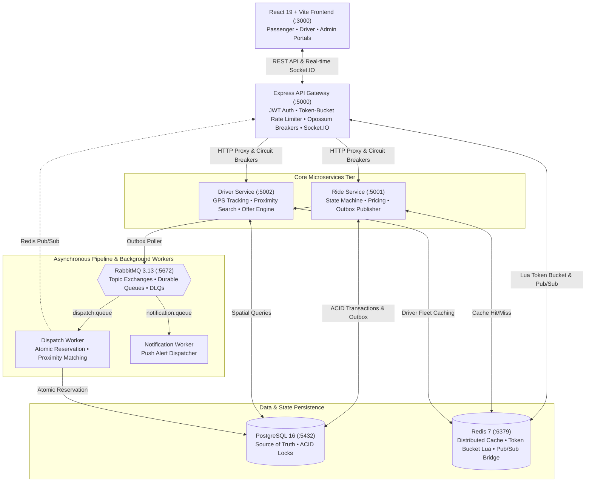

# RideFlow – Distributed Ride Booking and Driver Dispatch System
## 40-Mark Academic System Design Project (Complete Implementation)

**Setting & Operational Corridor:** Ahmedabad, Gujarat, India (SG Highway, Vastrapur Lake, CG Road, Riverfront, SVP Airport, GIFT City)  
**System Architecture Specification:** [docs/ACADEMIC_SYSTEM_DESIGN.md](file:///C:/Users/Lenovo/Desktop/Ride/docs/ACADEMIC_SYSTEM_DESIGN.md)  
**Evaluator Interactive Demo Guide:** [docs/DEMO_WALKTHROUGH.md](file:///C:/Users/Lenovo/Desktop/Ride/docs/DEMO_WALKTHROUGH.md)

---

## 1. System Architecture Overview

RideFlow is a high-concurrency distributed ride-hailing and dispatch microservices platform:



---

## 2. Microservice Ports & Endpoints

| Service / Component | Port | Technology | Primary Responsibilities |
| :--- | :---: | :--- | :--- |
| **Web Client Portal** | `3000` | React 19, Vite, Lucide | Passenger, Driver, and Admin Portals with live maps. |
| **API Gateway** | `5000` | Express.js, Socket.IO | Ingress routing, JWT security, Rate Limiting, Circuit Breakers. |
| **Ride Service** | `5001` | Express.js, PostgreSQL | State machine, Haversine pricing, Transactional Outbox. |
| **Driver Service** | `5002` | Express.js, Redis, PG | Proximity search, 3-second live GPS stream, 30s offers. |
| **PostgreSQL 16** | `5432` | PostgreSQL | 8 tables, spatial indexing, ACID row-level locking. |
| **Redis 7** | `6379` | Redis | Distributed token bucket Lua script, query caching, Pub/Sub. |
| **RabbitMQ 3.13** | `5672` / `15672` | AMQP 0-9-1 | Asynchronous dispatch queue, notification queue, DLQs. |

---

## 3. All 15 Milestones Status Matrix

| Milestone | Focus & Deliverable | Status |
| :---: | :--- | :---: |
| **M1** | Development environment & React website setup | **VERIFIED DONE** |
| **M2** | Express backend and API Gateway routing | **VERIFIED DONE** |
| **M3** | PostgreSQL database schema, migrations & seeds | **VERIFIED DONE** |
| **M4** | JWT Authentication & RBAC security | **VERIFIED DONE** |
| **M5** | Passenger and Driver dashboards | **VERIFIED DONE** |
| **M6** | Ride booking & lifecycle state machine | **VERIFIED DONE** |
| **M7** | Atomic driver dispatch algorithm & 30s offers | **VERIFIED DONE** |
| **M8** | Redis query caching & token-bucket rate limiting | **VERIFIED DONE** |
| **M9** | RabbitMQ async pipeline & Transactional Outbox | **VERIFIED DONE** |
| **M10** | Socket.IO real-time channels & GPS streaming | **VERIFIED DONE** |
| **M11** | Opossum circuit breakers & chaos engineering | **VERIFIED DONE** |
| **M12** | Docker Compose multi-container orchestration | **VERIFIED DONE** |
| **M13** | Jest & Node unit and integration test suites | **VERIFIED DONE** |
| **M14** | Grafana k6 performance, stress & load testing | **VERIFIED DONE** |
| **M15** | Final academic documentation, walkthrough & submission | **VERIFIED DONE** |

---

## 4. Evaluator Quickstart & Verification Commands

### Run Full Master Academic Verification (All 15 Milestones)
```powershell
npm run verify:all
```

### Run Automated Unit & Integration Tests (43 Tests Passed)
```powershell
npm test
```

### Run Grafana k6 Load Testing Suite
```powershell
npm run test:load
```

### Start Monorepo Services
```powershell
# 1. Start Infrastructure via Docker Compose
docker compose up -d postgres redis rabbitmq

# 2. Database Migration & Ahmedabad Seeds
npm run db:migrate
npm run db:seed

# 3. Start Backend Services
node gateway/src/server.js
node services/ride-service/src/server.js
node services/driver-service/src/server.js

# 4. Start React Frontend
cd frontend
npm run dev
```
Access the application at [http://localhost:3000](http://localhost:3000).
