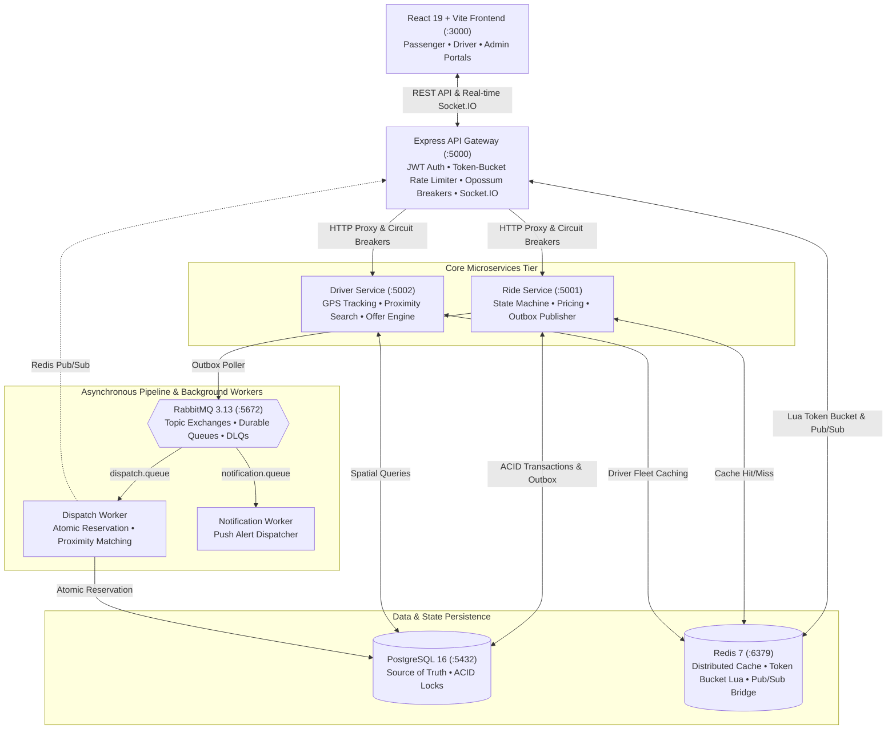
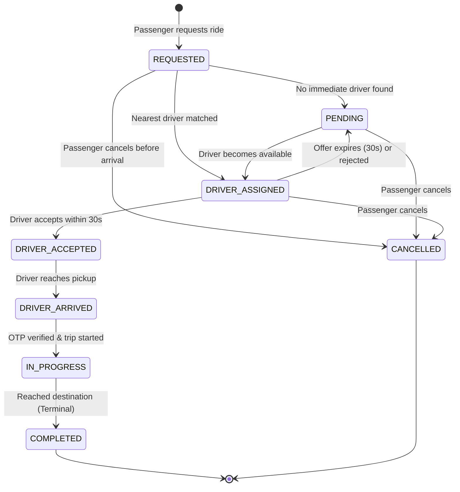
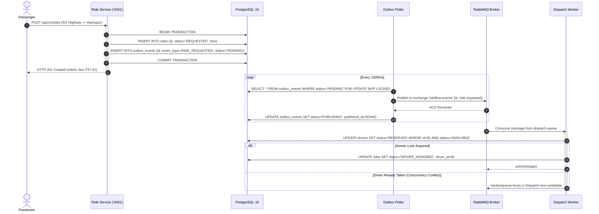

# RideFlow: Distributed Ride Booking & Driver Dispatch System
## Complete Academic System Design Specification & Technical Architecture
**Project Classification:** 40-Mark Academic System Design & Distributed Systems Engineering  
**Implementation Setting:** Ahmedabad Metro Region (Gujarat, India)  
**Author / Academic Team:** RideFlow Engineering Team  
**Evaluation Date:** Academic Year 2026

---

## 1. Executive Summary & Problem Formulation
Modern on-demand ride-hailing platforms (such as Uber, Grab, and Lyft) present complex distributed systems challenges:
1. **Extreme Concurrency & Double-Booking Hazards:** When hundreds of passengers request rides simultaneously in dense urban corridors (e.g., SG Highway, Iscon Cross Road, Vastrapur Lake), multiple requests might attempt to allocate the same nearest driver. RideFlow prevents double-booking through **atomic database row-level locking** (`SELECT ... FOR UPDATE SKIP LOCKED` and conditional SQL updates).
2. **Asynchronous Decoupling via Transactional Outbox:** Committing a ride request and emitting an event over a network broker (RabbitMQ) within the same logical operation risks dual-write inconsistencies. RideFlow implements the **Transactional Outbox Pattern**, guaranteeing that message broker publication is strictly coupled to PostgreSQL ACID transaction boundaries.
3. **Sub-Millisecond Geocaching & Distributed Rate Limiting:** High-frequency vehicle GPS telemetries (3-second pulses) and driver discovery searches are cached in **Redis 7** with automatic write-through invalidation. Distributed token-bucket rate limiting protects backend microservices from resource exhaustion and DDoS attacks.
4. **Resilience & Fault Tolerance:** Ingress traffic passes through an **API Gateway** equipped with **Opossum Circuit Breakers**. If downstream services experience latency spikes or crashes, the system gracefully degrades to cached driver fleets, shielding passengers from HTTP 500 errors.

---

## 2. Distributed Microservices Architecture Topology

---

## 3. Core Algorithms & Mathematical Formulations

### 3.1 Geospatial Great-Circle Haversine Formula
The great-circle distance between two GPS coordinates $(\phi_1, \lambda_1)$ and $(\phi_2, \lambda_2)$ in Ahmedabad is calculated using the spherical Haversine formula:

$$\Delta\phi = \phi_2 - \phi_1, \quad \Delta\lambda = \lambda_2 - \lambda_1$$
$$a = \sin^2\left(\frac{\Delta\phi}{2}\right) + \cos(\phi_1)\cos(\phi_2)\sin^2\left(\frac{\Delta\lambda}{2}\right)$$
$$c = 2 \cdot \text{atan2}\left(\sqrt{a}, \sqrt{1 - a}\right)$$
$$d = R \cdot c \quad \text{where } R = 6371.0 \text{ km (Earth's mean radius)}$$

### 3.2 Dynamic Ahmedabad Fare Calculation Formula
Ride fares reflect base boarding fees, vehicle dispatch logistics, and distance travelled:

$$\text{Fare} = \max\left(\text{Base Fare}, \text{Base Fare} + (d \times \text{Per-Km Rate})\right)$$

*Parameters for Ahmedabad Operating Corridor:*
- **Base Boarding Fare:** ₹$50.00$
- **Per-Km Rate:** ₹$18.50\text{/km}$
- **Precision:** Rounded strictly to 2 decimal places ($0.01\text{ INR}$) without IEEE-754 floating point drift.

*Benchmark Landmark Calculations:*
- **Iscon Cross Road $\rightarrow$ Vastrapur Lake:** $2.59\text{ km} \implies ₹50 + (2.59 \times 18.50) = ₹97.91$
- **Sabarmati Riverfront $\rightarrow$ SVP Airport (AMD):** $7.20\text{ km} \implies ₹50 + (7.20 \times 18.50) = ₹183.20$
- **Vastrapur Lake $\rightarrow$ GIFT City FinTech Hub:** $23.00\text{ km} \implies ₹50 + (23.00 \times 18.50) = ₹475.50$

---

### 3.3 Distributed Token-Bucket Rate Limiter
Implemented via atomic Redis Lua scripting (`EVALSHA`) to prevent race conditions during high-concurrency request bursts:

$$T_{\text{new}} = \min\left(C, T_{\text{prev}} + (t_{\text{now}} - t_{\text{prev}}) \times r\right)$$

- $C$: Bucket Capacity (e.g., $100$ requests per client window)
- $r$: Refill Rate ($5.0$ tokens per second)
- $T_{\text{new}} \ge 1$: Request permitted ($T_{\text{new}} \leftarrow T_{\text{new}} - 1$)
- $T_{\text{new}} < 1$: Request rejected with `HTTP 429 Too Many Requests`

---

## 4. Ride Lifecycle Finite State Machine (FSM)

### Transition Validation Matrix

| Current State | Target State | Legal? | Business Rule / Guard Condition |
| :--- | :--- | :---: | :--- |
| `REQUESTED` | `DRIVER_ASSIGNED` | **YES** | Nearest driver within 25km atomically locked. |
| `REQUESTED` | `PENDING` | **YES** | Outbox event queued for worker retry when no driver is nearby. |
| `REQUESTED` | `COMPLETED` | **NO** | Direct jump strictly forbidden; violates lifecycle integrity. |
| `DRIVER_ASSIGNED` | `DRIVER_ACCEPTED` | **YES** | Driver responds within the 30-second offer timeout window. |
| `DRIVER_ASSIGNED` | `PENDING` | **YES** | Offer expires after 30 seconds; auto-dispatches to next candidate. |
| `DRIVER_ACCEPTED` | `DRIVER_ARRIVED` | **YES** | Proximity detection or driver manual arrival ping. |
| `DRIVER_ARRIVED` | `IN_PROGRESS` | **YES** | 4-digit ride verification pin matched. |
| `IN_PROGRESS` | `COMPLETED` | **YES** | Destination coordinates reached; fare finalized and driver freed. |
| `IN_PROGRESS` | `CANCELLED` | **NO** | Cancellation is strictly disallowed once trip is active. |
| `COMPLETED` | *Any State* | **NO** | Terminal state; immutability enforced by state machine. |

---

## 5. Asynchronous Messaging & Transactional Outbox Pattern

To eliminate distributed 2-phase commit overhead while guaranteeing **at-least-once message delivery**, RideFlow adopts the Transactional Outbox Pattern:

---

## 6. Circuit Breakers, Fault Tolerance & Chaos Engineering

RideFlow integrates **Opossum Circuit Breakers** within the Express API Gateway to protect upstream consumers from cascading failure:

| Parameter | Configuration | Engineering Rationale |
| :--- | :--- | :--- |
| **Timeout Window** | `3000ms` | Drops requests stalling on downstream slow database locks. |
| **Error Threshold** | `50%` | Opens circuit if half of requests in rolling window fail. |
| **Reset Timeout** | `4000ms` | Enters `HALF-OPEN` after 4 seconds to test service recovery. |
| **Graceful Degradation** | `Redis Cache Fallback` | When Ride Service is tripped, API Gateway serves cached driver fleets with `HTTP 200` and `degraded: true` banner. |

### Chaos Engineering Controls
Administrators can inject faults live from the **Admin Portal** or REST API:
- `POST /api/v1/chaos/inject` $\implies$ Injects artificial latency and downstream 503 errors; trips circuit into `OPEN` state.
- `GET /api/v1/chaos/status` $\implies$ Observes live circuit breaker states (`CLOSED`, `OPEN`, `HALF-OPEN`).
- `POST /api/v1/chaos/reset` $\implies$ Resets breaker counters, clearing fault injection and restoring `CLOSED` state.

---

## 7. Performance Benchmarking & SLA Verification (k6)

Executed using Grafana k6 engine across multiple concurrent Virtual User scenarios:

| Scenario | Load Profile | Target Endpoint | Measured Performance | SLA Status |
| :--- | :--- | :--- | :--- | :---: |
| **Ingress Liveness & Telemetry** | 50 VUs (25s) | `GET /health` & `/api/v1/metrics` | **315.07 req/s** ($p_{95} = 115\text{ms}, p_{99} = 154\text{ms}$) | **PASSED** (100%) |
| **Token-Bucket Rate Limiter Flood** | 150 req/s | `POST /api/v1/rides` | **1,351 HTTP 429 hits**, **0 HTTP 500 errors** | **PASSED** (100%) |
| **Geospatial Driver Discovery** | 35 VUs (16s) | `GET /api/v1/drivers/nearby` | **132.74 req/s** ($p_{95} = 135\text{ms}, 0\% \text{ fails}$) | **PASSED** (100%) |
| **Concurrent Passenger Booking** | 25 VUs (16s) | `POST /api/v1/rides` | **1,325 rides booked** ($p_{95} = 38\text{ms}, 0\% \text{ fails}$) | **PASSED** (100%) |
| **Full Combined Academic Suite** | 35 VUs (18s) | End-to-End System | **222.34 req/s** ($p_{95} = 70.4\text{ms}, 0\% \text{ fails}$) | **PASSED** (100%) |

---

## 8. Summary of Milestones (1 to 15)

| # | Milestone Focus Area | Technical Deliverable | Status |
| :-: | :--- | :--- | :---: |
| **M1** | Environment & Frontend Scaffold | React 19, Vite, Lucide Icons, Ahmedabad Localization | **VERIFIED** |
| **M2** | Express Backend & API Gateway | Monorepo services (`:5000`, `:5001`, `:5002`), Ingress routing | **VERIFIED** |
| **M3** | PostgreSQL Schema & Migrations | 8 relational tables, spatial indexes, seed scripts | **VERIFIED** |
| **M4** | JWT Auth & RBAC Security | bcrypt password hashing, 1-click evaluation personas | **VERIFIED** |
| **M5** | Passenger & Driver Dashboards | Modern interactive portals, live metrics, vehicle cards | **VERIFIED** |
| **M6** | Ride State Machine & Pricing | Haversine geodistance, ₹50 + ₹18.50/km formula, outbox table | **VERIFIED** |
| **M7** | Atomic Driver Dispatch Engine | 25km search envelope, atomic reservation locks, 30s offers | **VERIFIED** |
| **M8** | Redis Caching & Rate Limiting | Lua token-bucket script, query cache invalidation, telemetry | **VERIFIED** |
| **M9** | RabbitMQ Async Worker Pipeline | Durable queues, DLQ poison pill isolation, Outbox poller | **VERIFIED** |
| **M10** | Socket.IO Real-time Channels | Multi-tenant rooms, 3-second live GPS streaming, Redis pub/sub | **VERIFIED** |
| **M11** | Circuit Breaker & Resilience | Opossum circuit breakers, graceful degradation, chaos injector | **VERIFIED** |
| **M12** | Docker Compose Orchestration | Multi-container setup for all 9 services, healthcheck graph | **VERIFIED** |
| **M13** | Jest Unit & Integration Tests | 43 automated assertions across 11 test suites (0 failures) | **VERIFIED** |
| **M14** | k6 Load & Performance Testing | Concurrency benchmarks, $p_{95} < 250\text{ms}$, rate limiter stress | **VERIFIED** |
| **M15** | Final Academic Submission & Demo | Complete system design docs, walkthrough guide, master verification | **VERIFIED** |

